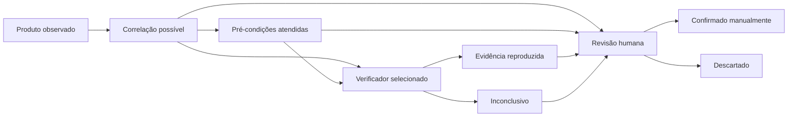

# Modelo de avaliação de vulnerabilidades

Revisão de 17/10/2026. Este documento descreve a implementação atual; substitui as contagens e opções da entrega inicial de três CVEs.

## 1. Observação e confiança

Produto, versão, fonte do sinal, evidência e confiança são registrados separadamente. Cabeçalhos e generator HTML fornecem versões **declaradas**, nunca uma garantia de versão instalada. Inventário fornecido pelo operador é identificado como tal, não como atestado independente. Fingerprints genéricos são “produto observado”, com versão desconhecida. Não se deduz a versão do Node.js pela presença de Next.js, nem a versão do Next.js por build ID, URL de bundle ou cabeçalho sem versão.

Aliases de inventário são normalizados: Node.js → nodejs, Next.js → nextjs, Apache → apache-httpd. O pacote npm `next` com versão explícita também alimenta o catálogo Next.js. O pacote npm chamado `node` não é automaticamente tratado como runtime Node.js. Sufixos de distribuição, versões incompletas e prereleases não entram no comparador local numérico.

## 2. Correlação passiva e rastreabilidade

O catálogo schema 2 admite intervalos separados por ramo, ordenados e sem sobreposição. Cada intervalo é `[introduced, fixed)`: o limite corrigido não é vulnerável. O schema 1 continua aceito para catálogos anteriores. Fontes, revisão do catálogo, evidência de versão, condições necessárias e condições ainda ausentes acompanham cada candidato.

Há cache de até 4.096 combinações produto/versão em memória; o catálogo incorporado é um snapshot local. Não há busca online NVD automática. Consultas opcionais OSV mantêm seu cache de 24 horas, limitado a 128 consultas e 8 MiB persistidos. Alterações de catálogo, inventário ou opções exigem novo estado. Uma rodada concluída não é reavaliada automaticamente após expirar o cache: inicie outro estado.

Condições são fornecidas em `facts`, com presença explícita e evidência. Só `present: true` acompanhado de evidência satisfaz uma condição. Ausência, false ou evidência vazia nunca promovem a avaliação. Todas as condições necessárias precisam estar documentadas para “pré-condições atendidas”; esse estado continua P5 e indica informação do inventário, não exploração comprovada.

## 3. Seleção e verificadores

```bash
./GoHunt --scope escopo.txt --state output/revisao.jsonl \
  --cve-mode verify --cve-verifiers joomla-public-users-v1
```

`--cve-mode verify` sem seleção explícita falha antes da coleta. IDs desconhecidos são rejeitados. O catálogo não pode criar código executável. O verificador disponível continua `joomla-public-users-v1`, para CVE-2023-23752: cinco GETs no máximo, controles antes/depois, rota inexistente, JSON estruturado e repetição. Suas fixtures incluem caso positivo, controle público, fallback genérico, HTML, dados vazios, instabilidade, controle final aberto, controle negativo inconclusivo e erro de transporte.

As onze novas entradas são para correlação e revisão de pré-condições. Não incluem testes de DoS, corrupção de memória, SSRF ou RCE. Adicionar um verificador exige implementação, identificação explícita e fixtures positivas/negativas. Nenhuma CVE é “confirmada manualmente” por código.

## 4. Estados no painel

| Estado                  | Critério                                                                |
| ----------------------- | ----------------------------------------------------------------------- |
| Produto observado       | Fingerprint ou componente identificado; versão pode ser desconhecida    |
| Correlação possível     | Produto/versão compatível, sem prova de todas as condições              |
| Pré-condições atendidas | Todas as condições cadastradas possuem evidência positiva no inventário |
| Evidência reproduzida   | O verificador específico satisfez seus controles                        |
| Confirmado manualmente  | Operador escolheu confirmar e registrou comentário                      |
| Descartado              | Operador escolheu descartar e justificou                                |
| Inconclusivo            | O teste executado não demonstrou a propriedade esperada                 |



Reabrir uma revisão restaura o estado automático original. A evidência automática permanece no journal; conclusão, comentário, revisão concorrente e data ficam no arquivo de revisões. Revisões antigas marcadas apenas como “verificadas” não são convertidas em vulnerabilidade confirmada. O painel permite revisar CVEs P5, além dos P1–P3 existentes, e filtrar todos os estados. Selecionar um estado ajusta o filtro de revisão para “Todos”, para que descartados e confirmados possam aparecer. Filtros persistem na URL.

## 5. Cobertura e fontes

O catálogo tem **14 CVEs**: Node.js (3), Next.js (2), nginx (3), Apache HTTP Server (5, incluindo duas anteriores) e Joomla (1).

| Produto | Novas entradas | Fonte primária |
| --- | --- | --- |
| Node.js | CVE-2026-56846, CVE-2026-56848, CVE-2026-58043 | [Release de julho](https://nodejs.org/en/blog/vulnerability/july-2026-security-releases) |
| Next.js | CVE-2026-75604 | [Advisory do mantenedor](https://github.com/vercel/next.js/security/advisories/GHSA-p293-qw3h-jr36) |
| Next.js | CVE-2026-94486 | [Release de setembro](https://nextjs.org/blog/september-2026-security-release), [GHSA](https://github.com/vercel/next.js/security/advisories/GHSA-39w2-rjm5-chcv) |
| nginx | CVE-2026-15176, CVE-2026-93479, CVE-2026-95101 | [Avisos oficiais](https://nginx.org/en/security_advisories.html) |
| Apache | CVE-2026-42356, CVE-2026-56449, CVE-2026-57941 | [Histórico oficial](https://httpd.apache.org/security/vulnerabilities_24.html) |

Para CVE-2026-94486, o limite inferior 16.0.0 vem do GHSA; o limite corrigido 16.3.8 vem do anúncio oficial de setembro. O campo corrigido do GHSA consultado ainda usava placeholder, portanto não foi usado como versão literal. Condição obrigatória: servidor de desenvolvimento com MCP; presença de Next.js em produção não basta.

As entradas Node.js cobrem os ramos 22, 24 e, quando indicado no aviso, 26. Outros ramos não são classificados por essas faixas; isso não significa que estejam seguros.

Revisão das fontes em 17/10/2026. Não é cobertura exaustiva nem ingestão automática de todos os avisos. Anúncios futuros e faixas sem informação suficiente não são preenchidos por suposição. As novas entradas produzem candidatos, não prova de exploração. Versões modificadas, proxies, backports e configurações desconhecidas continuam limitando a análise.

## Exemplo de inventário

```json
[
  {
    "url": "https://app.example.test/",
    "product": "Next.js",
    "name": "next",
    "ecosystem": "npm",
    "version": "16.3.2",
    "evidence": "Versão conferida no inventário autorizado",
    "facts": {
      "next.windows": {"present": true, "evidence": "Sistema confirmado pelo responsável"},
      "next.pages-and-app": {"present": true, "evidence": "Configuração de rotas revisada"},
      "next.without-cache-components": {"present": false, "evidence": "Cache Components habilitado"}
    }
  }
]
```

Nesse exemplo, uma condição está ausente: a versão pode gerar correlação, mas não o estado de pré-condições atendidas. Os nomes das condições aceitas por cada CVE estão em `Db/advisories.json`. Para consultar OSV, acrescente `--components inventario.json --osv`; apenas nome, ecossistema e versão são enviados ao serviço.
